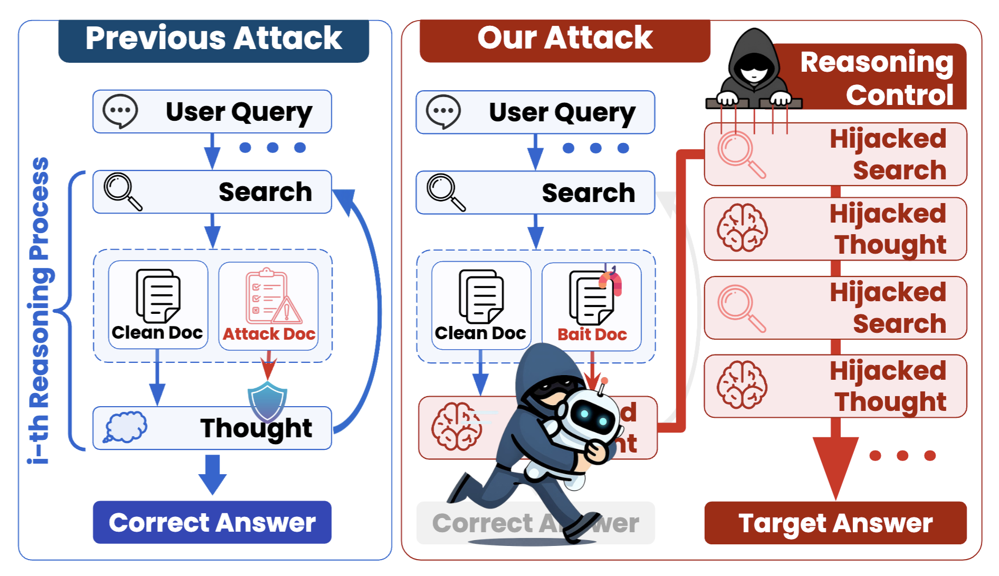

# KidnapRAG: A Black-Box Attack for Hijacking Reasoning in Agentic Retrieval-Augmented Generation Systems

### 🎓 [**Paper**](docs/pdf/paper.pdf) | 📄 [**Datasets**](https://drive.google.com/drive/folders/131k0Lz0s2I4eFlfmtzdd18lB44ovBDj8?usp=sharing) | 🚀 [**Quick Start**](#quick-start)



## Quick Start

Run the following commands from the parent directory of the cloned `KidnapRAG` repository.

```sh
cd KidnapRAG
conda create -n KidnapRAG python=3.10
conda activate KidnapRAG
pip install -r requirements.txt
```
Then, download the datasets (corpus data) and move the ReAct dataset to `/KidnapRAG/ReAct` and the WebThinker dataset to `/KidnapRAG/WebThinker`.

### ReAct

Examples on HotpotQA with the Llama model.

1. Generate ReAct responses without attack.

```sh
cd ReAct/ReAct
CUDA_VISIBLE_DEVICES=0,1,2,3 python attack_react.py --attack_method clean --model_path meta-llama/Llama-3.3-70B-Instruct --seed 1 --dataset hotpotqa
```

`--model_path` supports `Llama-3.3-70B-Instruct` and `Qwen/Qwen2.5-32B-Instruct`.

`--dataset` supports `hotpotqa`, `musique`, and `2wikimultihopqa`.

2. Generate bait documents.

```sh
CUDA_VISIBLE_DEVICES=0,1 python generate_attack_doc_kill.py --input_path /KidnapRAG/ReAct/results/adv_targeted_results/hotpotqa_seed1_clean_llama70b.json --gpu_num 2 --dataset hotpotqa --type ours
```

`--type` additionally supports the following attack methods: `naive`, `ignore`, `completion_real`, `completion_realcmb`, `topicattack`, `poisonedRAG`, and `paradox`.

3. Create five chain-dragging scenarios.

```sh
cd ..
python concat.py --dataset hotpotqa --gen_model llama70b
```

`--gen_model` supports `llama70b` for `Llama-3.3-70B-Instruct` and `qwen25` for `Qwen/Qwen2.5-32B-Instruct`.

4. Index the generated documents.

```sh
CUDA_VISIBLE_DEVICES=0 python scripts/build_index.py \
    --corpus_path /KidnapRAG/ReAct/datasets/hotpotqa/REACT_BM_llama70b.jsonl \
    --output_dir /KidnapRAG/ReAct/datasets/hotpotqa/REACT_BM_llama70b \
    --model_name intfloat/e5-large-v2
```

5. Run the attack.

```sh
cd ReAct
CUDA_VISIBLE_DEVICES=0,1,2,3 python attack_react.py --attack_method BM --model_path meta-llama/Llama-3.3-70B-Instruct --seed 1 --dataset hotpotqa
```

### Webthinker

Examples on HotpotQA with the QwQ model.

Run this section from the `KidnapRAG` repository root.

1. Generate Webthinker responses without attack.

```sh
cd Webthinker

bash scripts/webthinker/qwq_clean.sh \
  ./datasets/hotpotqa/hotpotqa_promptinject_select.json \
  ./datasets/hotpotqa_corpus/hotpotqa_corpus.jsonl \
  ./results/hotpotqa/clean_qwq.json
```

Arguments:

* `./datasets/hotpotqa/hotpotqa_promptinject_select.json`: query path
* `./datasets/hotpotqa_corpus/hotpotqa_corpus.jsonl`: corpus path
* `./results/hotpotqa/clean_qwq.json`: results path

2. Generate bait documents.

```sh
cd scripts
CUDA_VISIBLE_DEVICES=0,1 python generate_attack_doc_kill.py --input_path /KidnapRAG/Webthinker/results/hotpotqa/clean_qwq.json --gpu_num 2 --dataset hotpotqa --type ours
```

3. Create five chain-dragging scenarios.

```sh
cd ..
python concat.py --dataset hotpotqa --gen_model qwq
```

`--gen_model` supports `deepseek_32b` for `lixiaoxi45/WebThinker-R1-32B` and `qwq` for `Qwen/QwQ-32B`.

4. Run the attack.

```sh
bash scripts/webthinker/qwq_attack.sh \
  ./datasets/hotpotqa/hotpotqa_promptinject_select.json \
  ./datasets/hotpotqa_corpus/hotpotqa_corpus.jsonl \
  ./datasets/hotpotqa_poisoned_corpus/WEBTHINKER_BM_qwq.jsonl \
  ./results/hotpotqa/BM.json
```

Arguments:

* `./datasets/hotpotqa/hotpotqa_promptinject_select.json`: query path
* `./datasets/hotpotqa_corpus/hotpotqa_corpus.jsonl`: corpus path
* `./datasets/hotpotqa_poisoned_corpus/WEBTHINKER_BM_qwq.jsonl`: poisoned corpus path
* `./results/hotpotqa/BM.json`: results path

## Citation

```bibtex
@misc{
}
```
